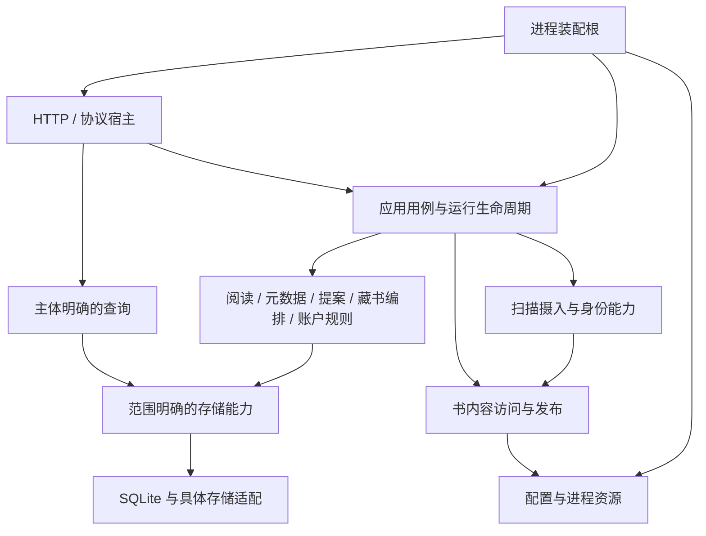

# 全项目架构再审视

阶段：设计已确认（2026-10-26），[规格](spec.md) 已就绪。本文记录已确认方向、审查证据与交付边界；后续需求与验收以规格为准，不将设计确认或规格就绪视为实施完成。

## 已确认方向

- 审查覆盖全项目大多数代码文件：后端功能与基础能力、应用装配、HTTP 与设备协议、数据库与 SQL、前端功能与页面、生成契约及测试边界；Controller 是其中一个观察点。
- 按问题采用 DDD：以业务概念、不变量、事务边界和生命周期审视模型及依赖；聚合、值对象与领域接口须有具体收益依据，不预设统一分层形状。
- 延续既有架构深化目标：规则集中、修改知识集中、减少调用者必须理解的细节，并通过完整用例验证一致性；文件大小与结构体数量只是审查线索。
- 区分书的藏书事实与明确主体的读者阅读视图，按语义逐步隔离持久化类型，保留对外 JSON 与匿名兼容语义。决定见 ADR 0010。
- 外部路径不得与任何已登记资料库目录重叠；跨资料库传输不借外部库接口隐式提供。词义见 CONTEXT.md。
- 提案部分应用与完整应用均须在写入事务中确认仍待裁决；进入终态后应用返回冲突且不提交本次写入，不撤销此前成功应用的字段。决定见 ADR 0011。
- 关系保存与作品群重建允许短暂分离；未完成依据须持久保留，失败自动重试、重启继续恢复，查询能够识别陈旧或失败状态。决定见 ADR 0012。
- 资料库删除先关闭该库新工作准入，请求取消可取消的本库运行并有界等待；仍被阅读、不可取消或跨库系统工作占用时返回明确冲突，不删记录。失败或放弃后释放准入、恢复符合当前设置的监听，如实报告已发生的取消；不自动重新执行工作。决定见 ADR 0013。
- 外部传输支持在复制分块检查点取消，丢弃未提交临时文件，保留已成功传输及原有文件；不承诺强行中断操作系统正在阻塞的单次 IO。暂停在块边界保留临时文件与偏移，释放可重新取得的 IO 配额，恢复前核对源与目标条件；不能确认安全续拷时失败并清理本次临时文件，不增加进程重启后的自动续传。
- 查询区分真实空值、未加载、失败与陈旧。已有成功结果可以保留并标为陈旧，首次失败提供不可用与重试；可降级的附属信息由功能定义，不统一强加通用页面状态框架。
- ADR 0008 完整落地纳入本轮独立主线，按重启行为区分入参与标签，并为每次有损合并记录事件；保留任务身份、队列及准入契约。
- 写入按业务不变量和窄事务能力组织；搜索、列表、详情与统计采用按场景设计的查询结果，保留批量 SQL、分页与缓存。无需为列表装载完整实体，也不增加独立读库或消息系统。
- 进程装配根独立于 Controller，先创建应用、资源与 HTTP 宿主，再向功能处理器注入所需能力；保持启动恢复与停机顺序，不以万能应用对象替代宽 Controller。
- 前端同步明确离线、配置编辑会话、资料库管理及任务等完整功能归属，页面与 Layout 保留局部视图状态，组件消费功能类型。读结果与编辑草稿分开，动作声明已提交影响、查询负责取数；AI 审核终态由后端权威返回。整体组织见 ADR 0014。
- 页读取、页清单与整书打开共享明确内容访问能力，集中来源定位、归档借还、图像加工、缓存资格及访问租约；书身份、设备匹配与协议保留不同接口，不建立包揽全部书业务的总对象。
- 配置按字段明确即时、后续作业或重启后生效，设置表达保存与生效的差异；一次操作目标、来源与写入意图不半途改变，资源预算在安全切换点更新，使用中的资源正常归还而非强行销毁。
- ComicInfo 临时归档构建尽量与读取并行，最终替换前取得书级短期写入资格，阻止新借用并有界等待已有读取；仍被占用或原文件已变化时明确失败并保留原文件，不强行截断阅读或下载。决定见 ADR 0015。
- 作品群已有成功结果时继续可读，明确标注更新中或更新失败及陈旧状态，保留后台退避修复并提供立即重试；首次尚无成功结果时显示不可用，不把空集合当重建完成。

## 审查方法

先建立功能、状态所有权、跨功能协作与生命周期图，再核对实现及调用者。分别记录实际已读文件、仅清单覆盖区域与未深入区域；生成代码通过生成源、契约消费者与漂移约束审查。

类型分别审视领域概念、用例输入结果、查询视图、传输契约、持久化记录与技术状态；辅助方法分别审视业务规则、应用协作、传输适配及基础设施职责。保留有明确职责的技术能力，不以新增层数作为收益。

## 访谈决策树

- 已确认 Q1–Q18：DDD 采用程度、模型分离、外部库含义、提案并发、作品群恢复、删库失败与占用、复制取消、查询失败语义、ADR 0008 范围、读写接口、独立装配根、前端功能归属、共享内容能力、块边界暂停、配置生效范围、归档发布协调及陈旧作品群呈现；全项目审查。
- 已根据当前证据形成完整能力、依赖、保留项、推荐顺序与完成判据；没有遗留需要另行询问的产品分支。
- Q19 已确认整体共同理解，访谈决策树收口。包名、内部文件布局、具体锁与事务适配、等待预算及退避常量由工程设计依据已确认约束选择；发现新的产品歧义再单独裁决。

## 全局组织候选

以下完整能力与依赖方向已确认，具体模块名、目录布局及实施拆票留给后续阶段。

| 能力 | 应持有的知识 | 应隔离的其他知识 |
| --- | --- | --- |
| 藏书与读者查询 | 藏书身份和事实、主体明确的阅读视图、列表/详情与继续阅读的查询含义 | HTTP 与 SQLite 生成形状、页面编辑草稿 |
| 领域写入用例 | 阅读、元数据来源、提案、人工与派生编排各自不变量及原子边界 | 全量 SQL 对象及由输入调用者手工补齐的事务配方 |
| 资料库管理 | 创建/修改/删除、访问协调、监听和后台工作交接、失败补偿 | HTTP handler 与导航壳的局部呈现 |
| 书内容与身份 | 来源定位、页清单/读取/加工、缓存及归档资源；内容与设备匹配证据的不同语义 | 设备协议、HTTP 响应规则及扫描整体编排 |
| 扫描摄入 | 文件发现、系列归属、身份重连、写入及安全清理的完整链 | 技术监听细节及多份运行准入 |
| 进程与技术能力 | 装配、恢复、停机、配置发布和资源生命周期、出站适配 | Controller 构造驱动进程以及全站业务规则 |
| 运行领域与投影 | 身份/状态/准入/重启声明、运行事件与采样各自事实；外部投影另有明确 owner | HTTP/SSE DTO 混入领域、日志冒充事件、参数与标签混用 |
| 前端应用能力 | 会话、离线归属与补传、功能查询和动作结果、配置编辑会话 | 页面目录成为全站能力 owner、读 DTO 直接承担编辑意图 |
| 账户与安全用例 | 初始化、账户不变量、凭据与会话效果、用户数据归属 | HTTP 认证呈现、Cookie/CSRF 与业务事务混成同一职责 |

各能力可包含多个内部模块，不把表关系直接等同聚合，不把目录直接等同 bounded context。下一轮仍须比较完整用例 interface、持久化 seam、查询模型与装配方式，再确定工程落点。

图中表示职责与消费方向，不要求每个框对应单个 Go 包；具体应用用例按功能组合所需能力，不经过一个包揽全部流程的总对象。文件监听输入与运行恢复也调用相应应用能力。

删除协调的实现约束：现有 task.Engine.AcquireLibraryExclusive 在无占用时才关闭准入，不直接满足先关闭后排空；新发起与已排队运行的放行必须共同遵守删除保留状态。取消、等待在引擎锁外进行，最终确认排空与升级排他访问须防止竞态；解除保留时恢复适用的队列放行。取消资格要同时判断任务作用域及实际覆盖，不能把涉及目标库的跨库运行视作可随该库取消。

## 文档归属

领域词汇沿用根 CONTEXT.md，仅在业务词义确认后更新。对有真实替代方案、逆转代价及后续解释价值的决定记录 ADR。现有 single-context 约定与已接受 ADR 按当前事实审查，发现调整理由时显式讨论。

## 推荐的结构与 interface

### 模型与原子保证

书的藏书事实不含隐式当前用户读态；读者阅读视图明确绑定站点用户或匿名兼容主体。查询入口负责完成主体解释，不能把 ProjectBooks 的先后顺序作为外部调用要求。负数或非法主体不自动解释为匿名。

阅读位置、清除依据、事实身份与该批必要聚合按已有原子边界提交；统计尽力写入的独立告警保留。合集成员与名称/归属约束由完整用例负责。提案在事务内确认待裁决并重载当前字段、锁定与系列事实，再决定本次应用，避免两个部分应用复用过期字段快照。元数据不同来源继续采用各自已确认语义。

不以表关系直接决定聚合，不为最后管理员约束建立装载全部用户的对象，不把整张作品群图纳入每次关系编辑的聚合。账户初始化、角色修改、删账户和改密作为完整应用用例核对不变量及会话效果；已有禁止删除自身、保留最后管理员、用户名按字节精确等规则继续有效，并验证并发下的原子保证。

### 写入与查询 seam

写用例可使用按一致性操作组织的事务回调，但回调只暴露所需能力，不返回全量 database.Queries 或任意 DB。适合位置更新的原子存储操作加业务决策形式可继续使用；不为所有功能套统一 UnitOfWork 或 CRUD Repository。

人工元数据编辑由完整应用 owner 组合事务、seriesmeta 来源规则和必要统计刷新；seriesmeta 不因此吸收运行发起、身份与跨功能生命周期。SQL 适配器在 implementation 内转换必要形状；涉及领域类型的具体适配避免让 database 反向导入已依赖它的领域模块。

列表、详情、搜索与统计各有批量查询 interface。已绑定读者的查询结果可由传输 adapter 展平成原 JSON；筛选、聚合、排序、计数与分页先使用主体事实，不能先分页再在内存叠加读态。继续阅读的下一本未读语义与阅读清单全部已读后的首书重读保持各自意图。

### 派生作品群恢复

按全局关系图范围维护持久期望版本与已应用版本，而非错误地按资料库分割跨库图。关系变更与更新依据同事务提交；修复读取一致图并将稳定身份、成员差集及本次已应用版本一起提交。重建期间的新变更仍保持待更新，旧失败不覆盖较新成功。

需要覆盖直接关系操作、系列/资料库删除导致的级联关系变化，以及影响派生结果的事实更新。运行与停止由既有应用运行时协调，不引入第二套运行准入或通用事件账本。

### 进程、宿主与资源

装配根先构造技术资源及传输所需 leaf effects，连接应用能力后执行登记、恢复及开放；HTTP adapter 不驱动应用创建。能力按功能注入，路由总装只组合 adapter，不能把整个应用图换名后注入每个处理器。

运行领域、任务落盘、HTTP/SSE 契约与转换分别保留明确归属。DTO 可以按功能归位，cmd/tsgen 的反射目标同步维护；移动类型的收益按导航与依赖清晰度验收，不把单纯移动记为规则深化。

页缓存归书内容能力，统计缓存归相应查询能力；失效由已提交的动作结果交接，不建设万能缓存总管。整书打开返回的读取句柄在关闭前持有必要访问资格；单页已物化为独立字节后可释放归档借用。调用者不负责推断归档池借还与迁移租约的配方。

配置保留 Save、Reload 与跨持久参与者 Coordinate 的不同补偿含义；资源由明确所有者发布和关闭。可先维持进程单实例，不以消灭全部包级变量为目标。设置按字段呈现生效范围，不自动迁移正在进行的写入目标。

### 扫描、身份与集成

扫描继续暴露完整摄入和清理用例，内部按发现、归档解释、身份认领、入库及安全清理组织。技术监听交付文件变化，摄入协调负责真实扫描完成、失败重排与清理资格；不得出现另一套扫描准入。

书身份、内容证据与设备文档键分别建模，scanner 不因获取指纹而依赖整个 KOReader 协议能力。既有哈希/路径口径、size+mtime 改名重连取舍与歧义保护保持；本轮不借模块调整改变身份算法或自动合并记录。

元数据搜索、推荐、分组和连通测试按真实消费者提供能力，同一供应商可以实现多个接口。上游格式 DTO、分页、重试、取消与错误归一放在适配 implementation，来源差异不抹平；不为每个新接口追加无行为转发层。

### 前端功能 interface

离线功能持有设备数据归属、书目/字节缓存、下载与补传队列的完整契约，auth 和离线书架消费它；保留断网、会话过期、显式登出、换人及首次认领的既有差异，不补造完整历史或升级为跨标签全局任务。

实现归属为 `web/src/features/offline/`：`offlineReader` 持有归属、缓存、书目、下载与事实队列，`offlineSession.endOfflineSession` 持有显式登出时的尽力补传、关闭服务端会话及释放本机归属顺序；`useReaderOffline` 与 `useOfflineShelf` 提供各自消费者的生命周期和投影。页面只渲染这些投影，不持有全站离线存储或补传配方；功能类型不依赖页面类型。缓存键、owner 代次、下载令牌、原发生时间与稳定事实身份沿用既有协议。

配置编辑会话持有分区字段归属、草稿、已保存基线与版本冲突；KOReader 账户诊断和维护能力独立消费。保存一个分区不保存其他分区草稿，刷新不替脏草稿偷换版本基线。连接协议共用分区保存锁，未提交的请求明确返回未提交结果，消费者不得宣告成功。KOReader 显式重载成功发布独立重载代次，由诊断功能刷新已发布状态；诊断刷新失败单独提示，不撤销已确认重载或冒充保存确认，迟到状态仍按请求代次隔离。系列读取 DTO 与编辑意图分开，表单不以 sql.Null 结构表达业务输入。

AI 审核动作返回后端权威候选与整单结果，前端合并投影并保留选区/滚动等状态。功能操作表达实际已提交范围与失效影响，查询和重试只负责取数；功能模型由功能持有，TaskCenter、气泡和 Layout 消费它。

各查询明确主干失败与可降级附属数据，保留陈旧结果时显式表达状态；迟到结果按身份、资料库、系列、书和请求代次核对当前作用域。状态归属不同不意味着合并成统一全站 store。

## 交付范围与保留项

本轮推荐范围包含上表全部主要能力。对每个区域必须给出明确归属和处置：已具备清晰职责则保留，存在重复规则或依赖泄漏则完成迁移；不能用每个文件都移动一次证明覆盖。审查发现但未复现的运行风险先补事实与回归，不直接扩大产品语义。

保留单一领域语境、现有部署方式、SQLite/sqlc、任务与运行身份、task/taskstore 分工，以及已有协议与外部 JSON/TS 名称。允许为明确冲突、已提交范围、生效时点和陈旧状态增加必要结果信息；不删除或静默改变既有字段含义。生成契约从其源重新生成，兼容转发仅作迁移手段，迁移结束移除无调用桥。

不在本轮引入微服务、全站事件总线、通用 outbox、独立读数据库、完整阅读事件账本、跨标签连接合并或重启后外部传输自动续传。不会因 DDD 改变哈希和改名重连算法、抹平元数据来源差异、重算不具备事实依据的阅读历史或把真实外部副作用当数据库回滚的一部分。

文件已替换、记录已删除或前批已提交之后的后续失败，结果必须保留已发生事实，并区分未提交、部分提交、已提交但后续未完成；不得返回会诱导调用者无条件重复写入的模糊失败。具体失效、补偿及修复由对应能力拥有，不用一套通用 saga 替代各自规则。

## 推荐推进顺序

按依赖推进、按完整功能验收；以下是设计顺序，不是实施工单或固定排期。

1. 明确事实、主体视图、输入结果与窄事务 seam；完成阅读查询/编辑、人工元数据和提案裁决的端到端迁移及并发回归，退出能绕过新规则的旧写入口。
2. 完成藏书编排的派生修复依据、重试及查询状态，并同步前端权威裁决结果、陈旧呈现和明确动作影响。保持关系图与稳定身份规则。
3. 统一资料库访问协调、内容借用及发布过程，完整交付删库、归档回写、外部传输的冲突、暂停、取消、部分成功及失败补偿。
4. 收拢扫描摄入/监听协作与书身份接口，梳理配置发布、资源生命周期、供应商消费能力；独立装配根，按功能收窄 HTTP 依赖，保持恢复与停机时序。
5. 完整落地 ADR 0008，归位运行 HTTP/SSE 契约及前端功能模型；完成离线、设置编辑会话、资料库管理和账户用例剩余整理，联合核对全部能力及文档。

前端功能、账户及集成能力可在相关接口确定后并行推进，不必等到最后一步；每条分支必须保留实际消费者与适用回归，不能以无人调用的新模块作为中间交付成果。

## 完成判据

- 结构：每项业务规则、事务含义、状态和生命周期有明确所有者；输入、页面和组件不再拼接迁出功能配方，模块不反向依赖协议或 UI；独立装配不重新制造全站总对象。
- 覆盖：审查记录区分文件索引、主要路径深读和运行验证；各主要区域有处置结论。最终验收映射到本轮规格及实际消费者，不用文件移动、代码行数或工单状态代替。
- 行为：真实临时 SQLite 验证主体隔离、分页、事务回滚、部分应用并发、派生修复跨重启和最后管理员等已有不变量；前端验证权威结果、草稿版本、失败/陈旧、身份及请求代次。
- 资源：验证删除关闭准入后旧队列也不放行、读者/运行真实退出后才释放，保留跨库工作；复制块边界暂停/取消保留正确文件，归档发布有界等待并核对文件变化、文件系统替换与后续失效。
- 生命周期：登记与恢复先于开放，停机先排空并等待使用者再释放资源；配置保存、文件重载与运行时生效分类一致，暂存工作及失败结果不误报完成。
- 门禁：适用 Go 测试、gofmt/lint、前端测试/lint/build、SQL 和 TS 生成漂移、文档检查及多平台 CI；竞态、故障注入与真实文件系统回归针对承重约束执行并记录实际结果。
- 交付：删除被替代的生产规则副本与无用兼容入口，更新当前职责与已实现 ADR 状态，CHANGELOG 记录批准的行为纠正；真实设备/外部供应商未实测之处明确列出。

## 后续阶段

本轮规格已发布至本地 Markdown issue tracker，状态为 ready-for-agent。后续按明确指令进入 to-tickets，最后 implement-spec；本文件保留设计依据，不自动创建工单或授权开始生产实现。
